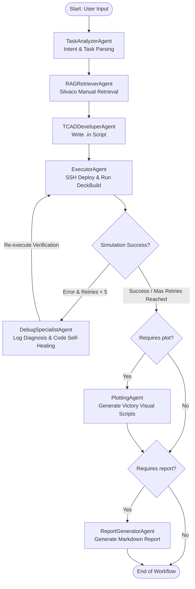

# TCAD Agent: Automated Semiconductor TCAD Multi-Agent System Powered by LangGraph & Google Gemini

[](https://www.python.org/)
[](https://github.com/langchain-ai/langgraph)
[](https://ai.google.dev/)
[](https://silvaco.com/)
[](https://www.docker.com/)

**TCAD Agent** 是一套專為半導體製程與元件工程設計的 End-to-End 自動化模擬系統。結合 **LangGraph Orchestration Framework**、**Google Gemini Multimodal Models** 與 **Hierarchical Parent-Child RAG**，能將使用者的 Natural Language Specifications 自動轉換為精確的 Silvaco TCAD 腳本，透過 SSH 自動發布至 Linux Workstation 執行 DeckBuild 模擬，並具備 **Self-Healing Debug Loop**、**Victory Visual Visualization Commands Generation** 與專業工程分析報告產出。

---

## 目錄

- [Key Features](#key-features)
- [System Architecture & Multi-Agent Workflow](#system-architecture--multi-agent-workflow)
- [Multi-Agent Roles & Responsibilities](#multi-agent-roles--responsibilities)
- [Hierarchical Multimodal RAG](#hierarchical-multimodal-rag)
- [Project Directory Structure](#project-directory-structure)
- [Environment & Prerequisites](#environment--prerequisites)
- [Quick Start](#quick-start)
- [Advanced Tools & Dataset Builder](#advanced-tools--dataset-builder)
- [Troubleshooting & FAQ](#troubleshooting--faq)

---

## Key Features

1. **Natural Language to TCAD Specifications**：支援從 High-Level Specifications（例如「28nm Gate-last NMOS」或「0.18 μm CMOS」）自動萃取技術目標與輸出偏好。
2. **Hierarchical RAG Knowledge Retrieval**：
   - 預先向量化官方手冊（DeckBuild、Victory Device、Victory Visual、Victory Process）。
   - 採用 **Parent-Child Architecture**，以細粒度 Child Chunks 進行向量檢索，並還原完整的 Parent Chunks 上下文，杜絕 Hallucination。
   - **Multimodal Layout Parsing**：透過 Gemini Vision 將手冊中的元件結構圖、電性特徵曲線與參數表格轉譯為語義化 Markdown。
3. **Seamless Remote CI/CD Execution**：
   - 內建 Fabric 模組透過 SSH 自動將腳本部署至遠端 Linux Workstation（如 `ws43`）。
   - 自動在背景調用 `deckbuild -run -ascii` 執行 Headless Batch Mode 模擬，並即時擷取收斂狀態與 Terminal Logs。
4. **Self-Healing Debug Loop**：
   - 當 DeckBuild 報錯或物理數值未收斂時，自動觸發 `DebugSpecialistAgent`。
   - 手術刀式剖析錯誤碼與語法，對照手冊規範即時修復代碼，支援最多 5 次自動 Retry 閉環。
5. **Data Visualization & Analysis Report**：
   - 自動編寫 Victory Visual CLI 命令，導出 2D Mesh 元件結構圖、Band Diagram、Id-Vg、Id-Vd 與 C-V 特徵曲線。
   - 彙整模擬收斂日誌與數值模型，自動產出具備工程價值的繁體中文 Markdown 報告。

---

## System Architecture & Multi-Agent Workflow

本系統基於 **LangGraph** 構建 **StateGraph**，透過全域狀態 `TCADState` 在各個 Agent 節點間傳遞上下文：



---

## Multi-Agent Roles & Responsibilities

| Agent Name | Model / Tech Stack | Core Responsibilities |
| :--- | :--- | :--- |
| **TaskAnalyzerAgent** | `gemini-2.5-flash` | 解析使用者原始輸入，萃取具體模擬目標（`technical_goal`）並辨識輸出偏好（`script`, `plot`, `report`）。 |
| **RAGRetrieverAgent** | `gemini-2.5-flash` + `AdvancedHierarchicalRAG` | 將技術目標轉換為最佳英文 Search Query，自本地向量庫檢索 Top-K 相關官方語法手冊。 |
| **TCADDeveloperAgent** | `gemini-3.5-flash` (temperature=0.1) | 嚴格依循官方手冊語法，合成完整 Silvaco `.in` 腳本（包含 Mesh、Process Steps、Electrodes 與 Physical Models）。 |
| **ExecutorAgent** | Fabric (SSH) | 將腳本安全上傳至遠端 Linux Workstation（如 `ws43`），非同步調用 `deckbuild` 執行模擬並分析日誌。 |
| **DebugSpecialistAgent** | `gemini-3.5-flash` (temperature=0.1) | 分析 DeckBuild Terminal Log 報錯原因（語法錯誤、不收斂、網格扭曲），對照手冊執行腳本 Self-Healing 修復。 |
| **PlottingAgent** | `gemini-2.5-flash` | 根據模擬產物（`.str`, `.log`），自動生成 `victoryvisual` 命列行指令以導出特性曲線與元件切面影像。 |
| **ReportGeneratorAgent** | `gemini-2.5-flash` | 彙整技術目標、模擬日誌、TCAD 程式碼與可視化圖表，產出包含五大章節的工程模擬分析報告。 |

---

## Hierarchical Multimodal RAG

### 1. 為什麼採用 Parent-Child Architecture？
傳統 RAG 在切分長篇 Silvaco User Manual 時容易面臨兩難：切塊太小會喪失製程順序與物理模型脈絡；切塊太長則導致向量相似度稀釋。
- **Child Chunks**：細粒度的段落、參數表格與圖表描述，建立稠密向量索引（`gemini-embedding-001`），確保檢索命中率。
- **Parent Chunks**：代表完整的 Sections / Chapters，Child Chunks 命中後自動向上索引還原完整的父級手冊上下文，提供 LLM 充足完整的指令語法。

### 2. Multimodal Layout Parsing & Diagram Transcription
透過 `src/tcad_rag_dataset_builder.py` 整合 `unstructured` 與 `PyMuPDF`，能精確辨識 PDF 中的：
- **Tables**：轉譯為結構化 HTML/Markdown 資料。
- **Images**：提取並傳送至 `gemini-2.5-flash` 進行多模態語義解析，自動將元件幾何結構、能帶圖、摻雜濃度輪廓轉譯為文字特徵，並存入 `datasets/tcad_api_cache.json` 快取。

### 3. 現有預載手冊資料集
系統已在 `datasets/` 目錄預載以下資料集：
- `datasets/deckbuild_rag_dataset.json` (73 MB) — DeckBuild 環境與執行控制指令
- `datasets/victorydevice_rag_dataset.json` (28.5 MB) — Victory Device 元件物理特性與電性模擬手冊
- `datasets/victoryvisual_rag_dataset.json` (7 MB) — Victory Visual 可視化數據與導圖命令

---

## Project Directory Structure

```text
tcad_agent/
├── datasets/                                # RAG 知識庫資料集目錄
│   ├── deckbuild_rag_dataset.json           # DeckBuild 手冊結構化向量庫
│   ├── tcad_api_cache.json                  # Multimodal 圖表語義解析快取
│   ├── victorydevice_rag_dataset.json       # Victory Device 物理手冊向量庫
│   └── victoryvisual_rag_dataset.json       # Victory Visual 繪圖手冊向量庫
├── docker/                                  # Docker 容器化環境
│   ├── compose.yaml                         # Docker Compose 配置 (支援 SSH Agent Forwarding)
│   ├── Dockerfile                           # 包含 OpenCV, Poppler, Tesseract 等底層庫之映像檔
│   └── entrypoint.sh                        # 容器啟動權限與 SSH 設定腳本
├── docs/                                    # 專案參考文獻與規格需求
│   └── references/
│       └── simulation_requirement.md        # CMOS/MOSFET 規格需求範例 (0.18μm / 28nm)
├── src/                                     # 核心原始碼
│   ├── __init__.py                          # Python 套件標記
│   ├── main.py                              # 主入口: LangGraph 流程圖組裝與執行啟動點
│   ├── tcad_config.py                       # 環境變數與 Google GenAI Client 初始化管理
│   ├── tcad_rag.py                          # Hierarchical RAG 檢索引擎 (NumPy 向量點積運算)
│   ├── tcad_rag_dataset_builder.py          # PDF 手冊版面解析與向量庫建置 Pipeline
│   ├── tcad_state.py                        # LangGraph 全域狀態字典 (TCADState) 定義
│   ├── tcad_agents/                         # 7 大 Multi-Agent 模組
│   │   ├── __init__.py                      # 模組統一匯出入口
│   │   ├── debug_agent.py                   # DebugSpecialistAgent: 錯誤診斷與自癒修復
│   │   ├── executor_agent.py                # ExecutorAgent: 遠端 SSH 執行與 Log 分析
│   │   ├── plotting_agent.py                # PlottingAgent: Victory Visual 導圖腳本
│   │   ├── rag_retriever.py                 # RAGRetrieverAgent: 檢索關鍵字生成與知識查詢
│   │   ├── report_agent.py                  # ReportGeneratorAgent: Markdown 報告生成
│   │   ├── task_analyzer.py                 # TaskAnalyzerAgent: 使用者規格與意圖解析
│   │   └── tcad_developer.py                # TCADDeveloperAgent: TCAD (.in) 腳本自動編程
│   └── testing_tools/                       # 診斷與連線驗證工具
│       ├── check_available_model.py         # 檢驗 Google Gemini Embedding 模型可用性
│       └── check_ssh_connection.py          # 測試遠端 EDA 工作站 SSH 讀寫權限
├── .env.example                             # 環境變數設定範例檔
├── .gitignore                               # Git 忽略清單
├── requirements.txt                         # Python 相依套件清單
└── README.md                                # 專案說明文件
```

---

## Environment & Prerequisites

### 1. Prerequisites
- **Python**: 3.11 或以上版本
- **Google Gemini API Key**: 具備 Gemini 2.5 / 3.5 與 `gemini-embedding-001` 權限之 API Key
- **TCAD Environment (Optional)**: 可透過 SSH 連線至已安裝 Silvaco TCAD / DeckBuild 之 Linux Server，或在本機以 Mock Mode 運行

### 2. Local Installation
```bash
# 1. Clone repository
git clone <repository_url>
cd tcad_agent

# 2. 建立並啟用 Python Virtual Environment
python -m venv venv
# Windows:
venv\Scripts\activate
# Linux/macOS:
source venv/bin/activate

# 3. 安裝相依套件
pip install --upgrade pip
pip install -r requirements.txt
```

### 3. Environment Variables
複製 `.env.example` 並重新命名為 `.env`：
```bash
cp .env.example .env
```
編輯 `.env` 檔案填入您的 Gemini API Key：
```env
GEMINI_API_KEY="AIzaSyYourGeminiApiKeyHere"
```
> [!NOTE]
> `tcad_config.py` 與 `tcad_rag.py` 內建防禦機制，會主動清理 `GOOGLE_API_KEY`，確保完全使用新版 `google-genai` SDK 與 `GEMINI_API_KEY`。

### 4. SSH Configuration
若需自動調用遠端 Linux Workstation 執行 DeckBuild，請確保本機已建立 `~/.ssh/config`，例如：
```ssh-config
Host ws43
    HostName 140.114.xxx.xxx
    User your_username
    Port 22
    IdentityFile ~/.ssh/id_rsa
```

### 5. Docker Deployment (Recommended)
本專案提供完整的 Docker Compose 配置，支援將宿主機的 SSH Agent Forwarding Socket 掛載至容器內：
```bash
cd docker
docker compose up -d --build
docker compose exec tcad-agent bash
```

---

## Quick Start

### 步驟一：執行診斷工具
在開始前，建議先確認 Gemini API 權限與工作站連線：
```bash
# 檢測 Embedding Models 是否就緒
python src/testing_tools/check_available_model.py

# 測試遠端工作站 SSH 讀寫權限 (需安裝 Fabric 並配置 ws43 Host)
python src/testing_tools/check_ssh_connection.py
```

### 步驟二：執行 Multi-Agent Workflow
直接執行主入口程式：
```bash
python -m src.main
```
或直接由 python 執行：
```bash
python src/main.py
```

#### 預設輸入與流程示範：
`main.py` 預設執行任務範例：
> *「模擬一個 28nm Gate-last NMOS 的製程，並輸出其 Id-Vg 曲線。自動寫好提取特徵的圖表代碼，並在最後給我一份詳細的分析報告。」*

執行時終端將顯示各 Agent 的即時運作狀態：
```text
=======================================================
啟動 TCAD Multi-Agent 物件化協作系統
=======================================================
 initializing RAG dataset (selecting: ./datasets/deckbuild_rag_dataset.json)...
 [Task Analyzer]: 正在解析使用者需求與輸出偏好...
 [RAG Retriever]: 正在向知識庫檢索相關語法與設定...
    產生的搜尋關鍵字: 28nm Gate-last NMOS Id-Vg curve simulation
 [TCAD Developer]: 正在根據 RAG 參考資料編寫模擬腳本...
 [Executor]: 正在伺服器 ws43 端部署並執行模擬腳本 (除錯循環: 0)...
    [Executor] 模擬順利跑通並成功收斂！
 [Plotting Agent]: 正在生成 Victory Visual 數據繪圖與影像導出指令...
 [Report Generator]: 正在彙整所有資訊，製作最終分析報告...
=======================================================
任務全部完成！
 總除錯次數: 0
 最終狀態: report_done
 最終 TCAD 腳本已匯出並存為 'task_current.in'
 已生成 Victory Visual/Extract 數據腳本
 分析報告已產出並存為 'final_report.md'
=======================================================
```

#### 產出成果：
1. **`task_current.in`**：符合 Silvaco DeckBuild 語法的可執行模擬程式。
2. **`final_report.md`**：包含製程步驟分析、Mesh 設定、物理模型選擇、數值收斂性評價與繪圖導出指引的繁體中文分析報告。

---

## Advanced Tools & Dataset Builder

### 1. Interactive RAG Query (`src/tcad_rag.py`)
若想單獨查詢 Silvaco 手冊語法，可直接啟動 CLI 查詢介面：
```bash
python src/tcad_rag.py
```
輸入查詢語句（例如 `how to define halo implant in victoryprocess`），系統將自動進行向量檢索並輸出相關章節內容與 Cosine Similarity 分數。

### 2. Manual Dataset Builder Pipeline (`src/tcad_rag_dataset_builder.py`)
若需導入新的 Silvaco PDF 手冊（如 Athena、Atlas、Victory Process）：
1. 建立 `./raw_docs` 目錄並放入 PDF 文件。
2. 執行建置程式：
   ```bash
   python src/tcad_rag_dataset_builder.py
   ```
3. Pipeline 將自動執行：
   - Multithreaded PDF Layout Parsing（分類 Text, Tables, Images）。
   - Gemini Vision 多模態圖表描述生成與快取機制。
   - Batch Embeddings（每批次 50 筆），產出結構化 JSON 向量資料庫。

---

## Troubleshooting & FAQ

### Q1: 本機未安裝 Fabric 或無法連線至遠端工作站 `ws43` 該如何處理？
> `ExecutorAgent` 具備 **Fallback Mechanism**。若本機未安裝 `fabric` 或連線中斷，執行器會自動進入 Mock Mode 並回傳模擬成功狀態，確保流程能順暢繼續執行後續的 Plotting 與 Report Generation 邏輯。

### Q2: 為什麼在 `tcad_rag.py` 中刪除了 `GOOGLE_API_KEY`？
> 新版 `google-genai` SDK 在某些環境若同時存在舊版 `GOOGLE_API_KEY` 與新版 `GEMINI_API_KEY`，可能導致授權衝突。專案透過 `_clean_environment()` 主動移除干擾變數，確保使用單一且正確的金鑰實例。

### Q3: 出現 `ModuleNotFoundError: No module named 'src'` 錯誤？
> 請確保是在專案根目錄下以模組形式運行程式：
> ```bash
> python -m src.main
> ```
> 或將當前目錄加入環境變數 `PYTHONPATH` 中：`$env:PYTHONPATH="."` (Windows PowerShell) 或 `export PYTHONPATH="."` (Linux)。

### Q4: 模擬未收斂或語法出錯時系統如何處置？
> 系統會自動將 DeckBuild 終端日誌的最後 50 行 Log 傳遞給 `DebugSpecialistAgent`，該 Agent 會比對手冊語法並微調物理模型參數或數值網格弛豫因子，隨後將修復後的代碼交還 `ExecutorAgent` 重新驗證，最多觸發 5 次 Self-Healing 重試迴圈。

---

## License & Acknowledgments
本專案專為半導體製程與電子元件模擬自動化研發。特別致謝 **Google Gemini API** 與 **Silvaco TCAD** 模擬工具。
